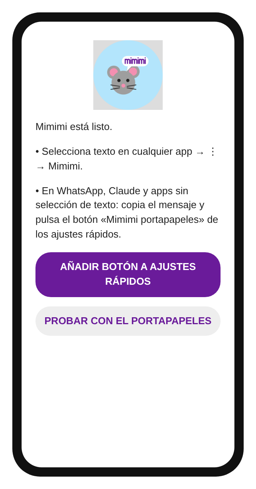
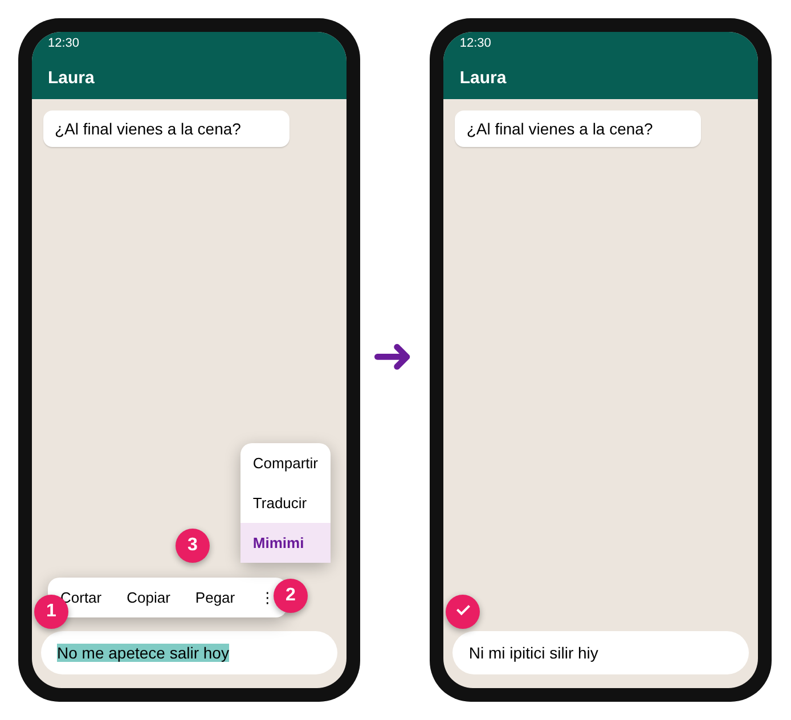
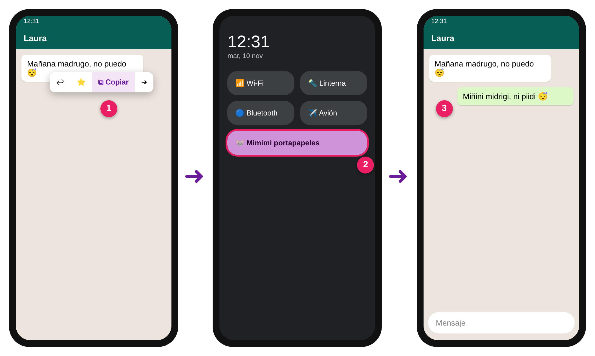

# Guía de usuario de Mimimi

Mimimi añade la opción **"Mimimi"** al menú que aparece al seleccionar texto en Android. Convierte todas las vocales en "i" (respetando mayúsculas y tildes) y copia el resultado al portapapeles.

> Ejemplo: `Hola, ¿qué tal estás?` → `Hili, ¿quí til istís?`

## 1. Descargar el APK desde GitHub

1. Desde el móvil, abre: **https://github.com/DaniBall/android-mimimi/releases/latest**
2. En **Assets**, pulsa **`mimimi.apk`** para descargarlo.

El APK se compila automáticamente con GitHub Actions en cada push y se publica en esa Release.

## 2. Instalar en Android

1. Abre el archivo `mimimi.apk` descargado (desde la notificación o la app *Archivos* → *Descargas*).
2. Si Android lo bloquea, pulsa **Ajustes** y activa **"Permitir de esta fuente"** para tu navegador/gestor de archivos (Ajustes → Aplicaciones → Acceso especial → Instalar apps desconocidas).
3. Vuelve atrás y pulsa **Instalar**.
4. Si Google Play Protect avisa de una "app desconocida", pulsa **Más detalles → Instalar de todas formas** (la app no está en Play Store, por eso avisa).

Requiere Android 6.0 o superior.

Al abrir Mimimi verás esta pantalla. Pulsa **Añadir botón a ajustes rápidos**:

> Tras instalar, **abre Mimimi una vez** desde el cajón de aplicaciones: Android no activa el botón de ajustes rápidos hasta que la app se ha abierto.

## 3. Cómo usarla

1. En cualquier app (WhatsApp, Chrome, Notas…), **mantén pulsado** sobre un texto para seleccionarlo.
2. En el menú flotante (Copiar, Compartir…) pulsa **⋮** (más opciones) si no ves la opción directamente.
3. Pulsa **Mimimi**.
4. El texto transformado queda **copiado en el portapapeles**. Pégalo donde quieras.

Reglas de transformación:
- `a e i o u` → `i`  ·  `A E I O U` → `I`
- Vocales con tilde aguda (`á é í ó ú`) → `í` / `Í`
- Otras vocales acentuadas (`ü`, `à`…) → `i` / `I`
- El resto de caracteres no cambian.

### Escribir en mimimi (WhatsApp, Telegram…)

En los **campos de escritura**, Mimimi **reemplaza el texto seleccionado** directamente (además de copiarlo):
1. Escribe o pega tu mensaje en el cuadro de texto.
2. Selecciónalo (mantén pulsado → *Seleccionar todo*).
3. Pulsa ⋮ → **Mimimi**. El texto se transforma en el sitio; solo queda enviarlo.

Para responder con burla a un mensaje de WhatsApp: cópialo, pégalo en tu cuadro de texto, selecciónalo y pulsa Mimimi.

### Apps donde no se puede seleccionar texto (WhatsApp, Claude…)

Algunas apps no usan el menú de selección estándar de Android (en WhatsApp se marca el bocadillo entero; en Claude solo aparece *Copiar* y *Seleccionar todo*). Hay dos alternativas:

**A) Compartir → Mimimi**
1. Mantén pulsado el mensaje y pulsa **Compartir** (en WhatsApp: ⋮ → *Compartir*, o selecciónalo desde otra app que lo permita).
2. Elige **Mimimi** en la lista. El resultado queda copiado.

**B) Botón de ajustes rápidos (la más cómoda, y la única en WhatsApp)**
1. Una sola vez: abre la app **Mimimi** desde el cajón de aplicaciones y pulsa *Añadir botón a ajustes rápidos*. Si tu Android no lo ofrece, despliega los ajustes rápidos (desliza dos veces desde arriba), pulsa ✏️ *Editar* y arrastra **Mimimi portapapeles** a tus botones (requiere Android 7+).
2. Copia el mensaje normalmente (en WhatsApp: mantén pulsado → icono de copiar).
3. Pulsa el botón **Mimimi portapapeles**. El texto del portapapeles se transforma y ya puedes pegarlo.

Las imágenes son ilustraciones; el aspecto real depende de tu móvil y de la app.

## 4. Actualizar y desinstalar

- **Actualizar:** descarga el nuevo `mimimi.apk` de la Release y vuelve a instalarlo encima.
- **Desinstalar:** Ajustes → Aplicaciones → **Mimimi** → Desinstalar.

## Problemas frecuentes

| Problema | Solución |
|---|---|
| No aparece "Mimimi" en el menú | Pulsa ⋮ en el menú de selección; algunas apps (p. ej. ciertos teclados o apps bancarias) no admiten acciones de texto. |
| "App no instalada" | Desinstala la versión anterior y vuelve a instalar. |
| No aparece el botón en ajustes rápidos | Abre la app Mimimi una vez y pulsa *Añadir botón*. Reinicia el móvil si sigue sin salir. |
| WhatsApp no deja compartir el texto | Normal: copia el mensaje y usa el botón de ajustes rápidos. |
